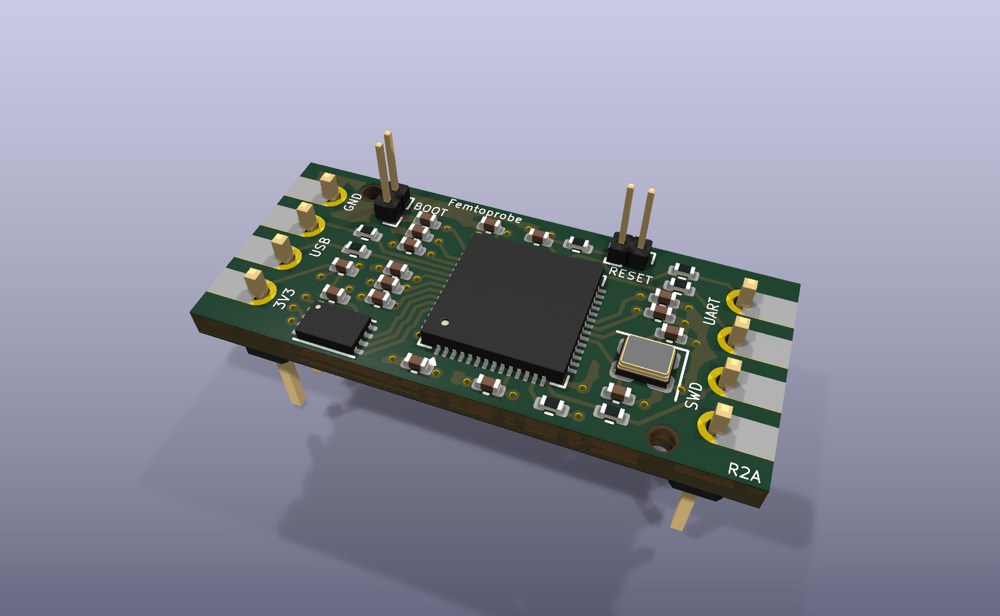

# Femtoprobe

*Femtoprobe R2A, rendered in KiCad.*

The Femtoprobe is an ultra-compact SWD and UART debug probe for [APEC SoM](https://github.com/variegated-coffee/apec-som) carrier boards, built around the RP2040. It's smaller than a Picoprobe, and it connects to the host through one of the APEC SoM's built-in USB hub ports, so a single USB-C cable to the carrier board carries both the controller's USB and the debug probe.

The Femtoprobe is either meant to be fitted on a pin header during development and removed when it's no longer needed, or to be soldered on using the castellated pins. It isn't as feature-rich as the Raspberry Pi Debug Probe or as sophisticated as a J-Link; its strengths are simplicity and size.

## High-level features

* RP2040 microcontroller with 2 MB of QSPI flash and a 12 MHz crystal, the same flash and crystal as the Raspberry Pi Pico
* USB full-speed device interface on the castellations
* SWD (SWCLK, SWDIO) and UART (TX, RX) target interface, with 100 Ω series resistors
* Runs from a 3.3 V supply provided by the carrier
* BOOT and RESET pads for entering the USB bootloader
* 27.93 × 12.13 mm, 4 layers, 8 castellated pins on a 2.54 mm pitch; the pins also take ordinary 2.54 mm pin headers

## Firmware

The Femtoprobe is intended to be used with the [Raspberry Pi Debug Probe firmware](https://github.com/raspberrypi/debugprobe). The board *does* however use different IO assignments, and as such, a small firmware patch is provided in [firmware-patch.diff](firmware-patch.diff).

## Project status

The current hardware revision is R2A. It hasn't been manufactured yet, and you probably shouldn't be the first one to do it. The earlier engineering validation revisions, EV1, have been manufactured;

## Documentation

* [ENGINEERING-NOTES.md](ENGINEERING-NOTES.md): pinout, power, interfaces and carrier-board design
* [MANUFACTURING-NOTES.md](MANUFACTURING-NOTES.md): fabrication, assembly and bring-up

## Notice

This repository contains design files only. It is not a finished product, and it has not been tested or certified for compliance with any regulation, including but not limited to CE, UKCA or FCC requirements.

Anyone who manufactures, assembles, or places a product based on these files on the market does so as the manufacturer of that product, and is solely responsible for its safety, conformity assessment, marking, documentation, and any legal obligations that follow. If you build or use it yourself, you do so at your own risk.

The designs are provided “as is” under the CERN-OHL-P v2. See sections 5.1 and 5.2 for the disclaimer of warranty and limitation of liability.

## License

The design files and documentation in this repository are licensed under the CERN Open Hardware Licence Version 2 – Permissive (CERN-OHL-P-2.0); see [LICENSE.txt](LICENSE.txt).

The schematic and PCB contain copies of symbols, footprints and 3D model references from the KiCad libraries, which keep their own licence; see [THIRD_PARTY.md](THIRD_PARTY.md).
